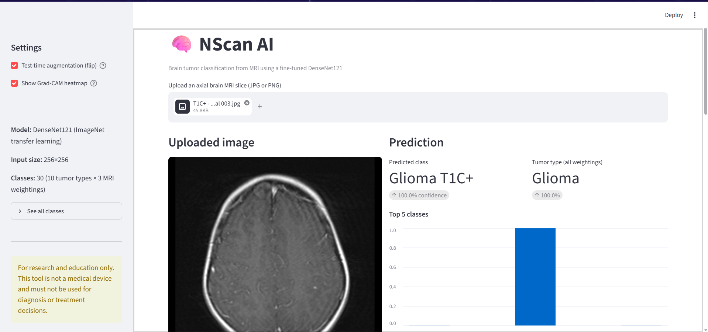
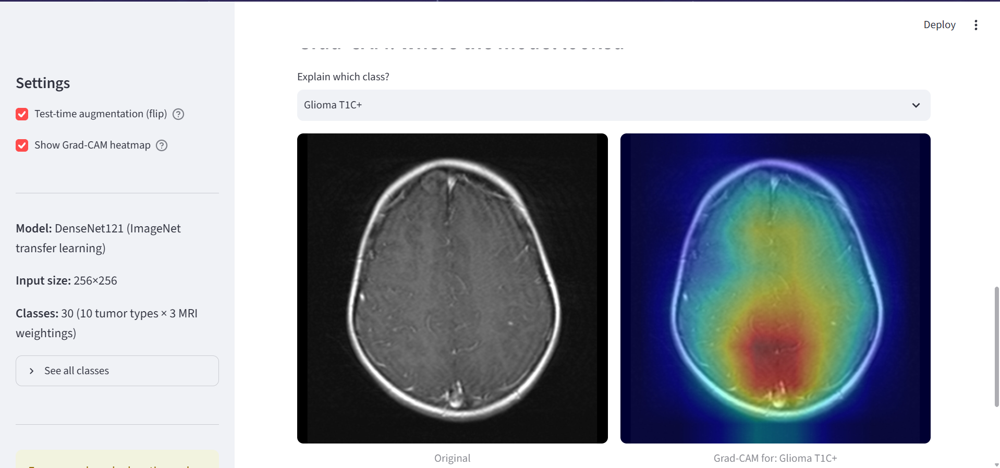

# NSCAN AI — Comparative CNN Approach with Grad-CAM for Tumor Region Identification

> **GitHub "About" description (copy into the repo's About box):**
> Comparative study of DenseNet121, ResNet50 and EfficientNetB0 for 30-class brain tumor MRI classification, with Grad-CAM to highlight the image regions driving each prediction.
>
> **Suggested topics:** `deep-learning` `medical-imaging` `brain-tumor` `mri` `grad-cam` `explainable-ai` `transfer-learning` `densenet` `resnet` `efficientnet` `tensorflow` `keras`

---

## About

**NSCAN AI** (NeuroScan AI) classifies brain MRI slices into **30 classes** (10 tumor/normal types × 3 MRI weightings: T1, T1C+, T2) and compares three ImageNet-pretrained CNNs under an identical training pipeline. **Grad-CAM** is then used to visualise *where* each network looks, so predictions can be checked against the actual tumor region rather than trusted as a black box.

## Dataset

- **Source:** Kaggle — [`fernando2rad/brain-tumor-mri-images-30-classes`](https://www.kaggle.com/datasets/fernando2rad/brain-tumor-mri-images-30-classes)
- **Size:** 11,300 images, 30 classes (e.g. `Meningioma T1C+`, `Schwannoma T2`, `Normal T1`)

## Method

| Component | Details |
|---|---|
| Models | DenseNet121, ResNet50, EfficientNetB0 (ImageNet weights) |
| Input | 256 × 256 RGB, model-specific preprocessing built into the network |
| Head | GlobalAvgPool → BatchNorm → Dropout(0.2) → Dense(256, ReLU, L2) → Dropout(0.1) → Softmax(30) |
| Augmentation | Horizontal flip, rotation ±5%, zoom 5%, translation 3% (no contrast change, since T1/T1C+/T2 differ by intensity) |
| Training | **Phase 1:** frozen backbone, 10 epochs, LR 1e-3. **Phase 2:** full fine-tune (BatchNorm frozen), up to 40 epochs, LR 2e-5 |
| Callbacks | EarlyStopping (val accuracy, patience 8), ReduceLROnPlateau |
| Imbalance | Balanced class weights |
| Inference | Test-time augmentation (original + horizontal flip averaged) |
| Explainability | Grad-CAM heatmaps over the final convolutional feature map |

## Results (test set, 1,695 images, 30 classes)
## Demo






| Model | Test Accuracy | Macro Precision | Macro Recall | Macro F1 | Weighted F1 | Best Val Acc |
|---|---|---|---|---|---|---|
| **DenseNet121** | **0.93** | 0.93 | 0.92 | 0.92 | 0.93 | 0.9286 |
| **ResNet50** | **0.93** | 0.93 | 0.92 | 0.92 | 0.93 | 0.9263 |
| EfficientNetB0 | 0.84 | 0.85 | 0.83 | 0.83 | 0.84 | 0.8383 |

Test metrics come from the notebook's classification reports (rounded to two decimals there). Best Val Acc is the peak validation accuracy logged during training.

**Takeaways**

- DenseNet121 has a slight edge over ResNet50 (best validation accuracy 92.86% vs 92.63%); on the test set both round to 0.93. EfficientNetB0 is about 9 points lower under the same recipe.
- The weakest classes are the small T2 classes, e.g. Hemangiopericytoma T2 and Oligodendroglioma T2 (recall about 0.71–0.76 on DenseNet/ResNet), plus Schwannoma T1/T2 where precision drops (about 0.77–0.89).
- Classes such as Neurocytoma T1C+ and Normal T1C+ reach F1 close to 1.00 on DenseNet121.

## Grad-CAM: identifying the tumor region

Grad-CAM weights the last convolutional feature maps by the gradient of the predicted class score, producing a heatmap overlaid on the MRI. For each model the heatmap is used to check whether attention falls on the lesion or on irrelevant areas (skull, background, scanner artifacts), and the three architectures' maps are compared side by side on the same images.

> **Note:** the Grad-CAM code and overlay figures are not in the current notebook (`upate (3).ipynb`), which covers training and evaluation only. Add the overlay images under `assets/` and reference them here, e.g. ``.

## Repository structure

```
.
├── upate (3).ipynb     # data loading, training, evaluation (all 3 models)
├── preds/              # saved val/test probabilities per model (.npy)
├── assets/             # Grad-CAM overlays and figures
└── README.md
```

## Getting started

```bash
pip install tensorflow kagglehub numpy pandas matplotlib seaborn scikit-learn
```

1. Set up your Kaggle API credentials (the dataset downloads through `kagglehub`).
2. Open the notebook and run the setup cells.
3. Run one training cell per model (`run_model("DenseNet121")`, `run_model("ResNet50")`, `run_model("EfficientNetB0")`). Each is independent and saves `<Model>_brain_tumor.keras`.

A GPU is strongly recommended.

## Disclaimer

This is a research and educational project. It is **not** a medical device and must not be used for clinical diagnosis or treatment decisions.

## License

Add your preferred license (e.g. MIT).
